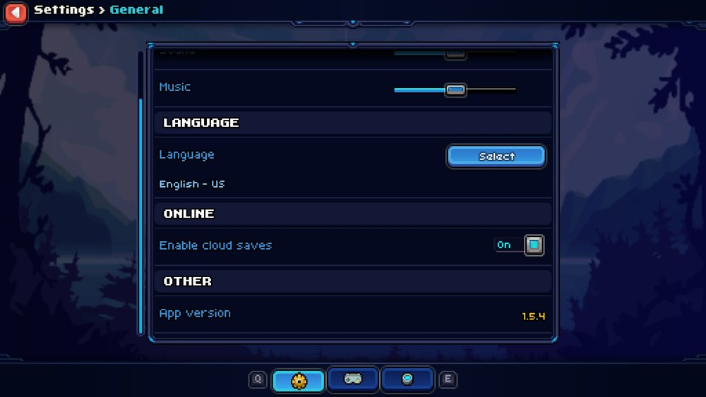

<hr>

<div align="center"> 
    
</div>

<div align="center"> 

### chalchiu

Modding support for Solar2D Games  

*Designed for [Coromon](https://store.steampowered.com/app/1218210/Coromon/)*

</div>

---

> **Warning**  
> Please do not report any issues that may've been caused through this project to the official game developers as they will not assist you with broken games / saves when you are using mods.  
> Please [open an issue here](https://github.com/zreezy/chalchiu-coromon/issues/new) instead!

> **Note**  
> This is a fork of [Curve/chalchiu](https://github.com/Curve/chalchiu) by Curve, updated to work with Coromon v1.5.4 (2026) and maintained by Zreezy.  
> Licensed under the [MIT License](LICENSE).

# Introduction

This Project aims to add mod support to [Coromon](https://store.steampowered.com/app/1218210/Coromon/) but is implemented in such a way that it should also work for other Solar2D Games.

The [wiki](https://github.com/zreezy/chalchiu-coromon/wiki) has everything in this README plus the full game reference, in an easier to browse format.

# Usage

The installation of chalchiu is fairly simple:

* Check your game version: in Coromon, open **Settings → General** and scroll to **App version** at the bottom.
  This release supports **v1.5.4**; on other versions some mods may not work.

  

* Locate your Game Folder
  > e.g. `C:/Program Files (x86)/Steam/steamapps/common/Coromon/` (Steam: right-click Coromon → Manage → Browse local files)

* Download the zip file from the latest [Release](https://github.com/zreezy/chalchiu-coromon/releases/latest) and unpack all files into the game directory
  * Your Game Folder should now roughly look like this
    > Please note that some files have been omitted
    ```
    📂 C:/GOG Games/Coromon
    ├── coromon.exe
    ├── CoronaLabs.Corona.Native.dll
    ├── corona-plugins
    ├── iphlpapi.dll
    ├── libeay32.dll
    ├── lua.dll
    ├── mods
    ├── ...
    ```
* Start the Game, the following things should happen:
  * A Log File named `chalchiu.log` is created
  * A Folder named `mods` is created in the game directory
  * Your Game Window Title includes information about the loaded mods

* Updating: unzip the new release over the old files, replacing `iphlpapi.dll` and the mod files. Your mod settings
  (`mods/<mod>/settings.lua`) are not in the zip, so they are kept. If the changelog says a mod was removed, delete its folder.

# Coromon

<details><summary>Continue Reading...</summary>
<p>

Here you'll find information about the provided Coromon mods!  

The mods were originally written for v1.1.2 and have been updated for v1.5.4 (Solar2D 2026.3729). See [docs/game](docs/game) for a reference of the game's modules per version.

## Available Mods

Every mod's settings (including all hotkeys) can be changed in-game: open the **Loaded Mods** popup
(shown on startup, with the **Mods** button on the title screen, or with the info button next to your gold
in the pause menu), select a mod and press **Settings**. On a settings page the blue button changes the
selected setting (its label says what it does, e.g. **Turn on**, **Next** or **Set key**) and the red button
(or `Esc`) goes back. Changes are saved right away to `mods/<mod>/settings.lua`, there is no save button.

- **Mod Info**
  > Shows the loaded mods on startup and from the pause menu, and lets you change each mod's settings.
  

- **Coromon Trainer**
  > Hotkeys for game speed, noclip, catching every Coromon, skipping wild/trainer battles, maxing out your squad,
  > adding gold and items, no energy cost, faster battle intros, hiding the interface and more. Keys, gold amount
  > and the item to give are configurable. Battle cheats are switched off automatically in online battles.
  

  | Default key | Action |
  |---|---|
  | `numPad+` / `numPad-` / `numPad*` | Increase / decrease / reset game speed |
  | `numPad/` | Toggle noclip |
  | `numPad1` | Catch all Coromon |
  | `numPad2` | Skip wild battles |
  | `numPad3` | Max out squad |
  | `numPad4` | Add gold |
  | `numPad5` | Skip trainer battles |
  | `numPad6` | No energy cost |
  | `numPad7` | Fast battle intros |
  | `numPad8` | Hide world interface (screenshots) |
  | `numPad9` | Give item |
  | (unbound) | No move damage (affects everyone) |

- **Potent Alert**
  > A notification and sound when a potent or perfect Coromon appears in a wild battle.

- **XP & Gold Boost**
  > Multiplies battle XP (2x by default) and trainer gold rewards. No effect in online battles.

- **Text Speed+**
  > Dialogue text faster than the game's 3x maximum (6x by default).

- **Area Encounter Info**
  > Press `numPad0` in the overworld to see which Coromon live in your current area, their chances and which ones
  > you've seen, using the game's own world map popup.

- ~~Randomize Evolution~~ (removed)
  > Randomized evolutions are now a built-in option in the game's Custom Difficulty screen, so this mod is no longer needed.

</p>
</details>

# For Modders

<details><summary>Continue Reading...</summary>
<p>

## Example Mods

You can find some example mods in the [scripts](./scripts) folder.  

A `debug` mod is also included, which will dump all modules loaded by the game into the log.  
This is especially useful when you don't want to unpack the precompiled lua scripts the game uses, as just having information on the game modules is often enough to get started.

## Writing a Mod

Creating a mod is fairly simple.  
All you need to do is create a folder for your mod and place an `init.lua` inside of it.

The `init.lua` **is the only file that is explicitly loaded** by chalchiu.  
You can however use `require` to load any files from the same directory your mod resides in.

You are expected to return a table containing some information about your mod from your `init.lua`.

<table>
<tr>
<td>(Example) init.lua</td>
</tr>
<tr>
<td>

```lua
require("hooks") -- Will load the `hooks.lua` residing in the same directory

return {
  name        = 'Name', -- The name of your mod
  author      = '....', -- Who wrote the mod?
  version     = '....', -- Current version of your mod
  description = '....', -- The description of your mod
}
```

</td>
</tr>
</table>

## Utilities

There are some utilities you can use from within your mod.

### Hooks

Hooks are an essential part of mods, as they allow you to modify modules loaded by the game as well as allowing you to dictate when a certain piece of code is run.

Hooks in chalchiu allow you to intercept lua `require` calls, which allows you to e.g. modify the original table and replace certain game logic with your own.

All you need is the name of a `module` you want to hook. _(To get a list of modules you can use the [debug mod](scripts/debug/))_

<table>
<tr>
<td>Registering a hook</td>
</tr>
<tr>
<td>

```lua
hooks.add("module.to.hook", function(table)
  -- `table` is the original table that would've been returned

  -- You can now fully alter the table, and e.g. overwrite some function:
  table["max"] = table["min"]
end)
```

</td>
</tr>
</table>

### Detours

The `detour` function allows you place a detour on any lua function and is often used together with [hooks](#hooks).

Detours can be useful for many things, e.g. modifying the players money when a save game is loaded.

<table>
<tr>
<td>Example Detour</td>
</tr>
<tr>
<td>

```lua
hooks.add("classes.localPlayer", function(table)
  detour(table, "getMoney", function(original, self, ...)
    -- `original` refers to the "original" (i.e. non detoured version) of the function
    local originalMoney = original(self, ...)
    return originalMoney * 1000
  end)
end)
```

</td>
</tr>
</table>

### Settings

`settings.define` declares your mod's settings. Values are loaded from `mods/<your mod>/settings.lua` (if it exists),
saved whenever they change, and shown on your mod's settings page in Mod Info.

Supported types: `boolean`, `number` (`min`, `max`, `step`), `choice` (`options`), `key` (a key name, for hotkeys)
and `string` (file only). `label` and `description` are shown in-game.

<table>
<tr>
<td>Defining settings</td>
</tr>
<tr>
<td>

```lua
local config = settings.define({
  { key = "multiplier", label = "XP multiplier", type = "choice", default = 2,
    options = { { value = 1, label = "Off" }, { value = 2, label = "2x" }, { value = 3, label = "3x" } } },
  { key = "sound", label = "Play a sound", type = "boolean", default = true },
  { key = "hotkey", label = "Key: Do the thing", type = "key", default = "numPad5" },
})

print(config.multiplier)      -- current value
config:set("sound", false)    -- validated and saved
config:onChange(function(key, value) end)
```

</td>
</tr>
</table>

### Hotkeys

`hotkeys.add` runs a function when a key is pressed. Pass a function instead of a key name to read the key from your
settings on every press, so rebinding in Mod Info works immediately.

<table>
<tr>
<td>Registering a hotkey</td>
</tr>
<tr>
<td>

```lua
hotkeys.add(function() return config.hotkey end, function()
  print("pressed!")
end, "Do the thing")
```

</td>
</tr>
</table>

### Game reference

[docs/game](docs/game) lists every game module, its functions (with parameter names) and settings, plus all globals,
for each supported game version. Run `python tools/gamedocs/gamedocs.py check scripts/coromon --version <version>`
to find references to modules or settings that no longer exist, and `lua5.1 tests/run.lua` to run the offline tests.

Hooks registered for a module the game has already loaded are applied immediately.

### Globals

Every mod is loaded in its own lua environment, thus it does not have write access to the global lua table.  

If you need explicit write access to the global table, you can use the `globals` variable, which refers to the global lua table used by the game.

> Most of the time you will not need this, however this can sometimes be useful, e.g. when you want to require one of the games files.

<table>
<tr>
<td>Simple Demonstration</td>
</tr>
<tr>
<td>

```lua
local not_math = require("math") -- This will fail as it will look for a `math.lua` inside of your mod!
local math = globals.require("math") -- This will load the same math as used by the game
```

</td>
</tr>
</table>


</p>
</details>
# Releasing

Every push builds chalchiu on GitHub Actions (the zip is attached to the run as the `chalchiu` artifact).
A GitHub release is only published when the version changes:

1. Bump `VERSION` in the `project(...)` line of [`CMakeLists.txt`](CMakeLists.txt) (e.g. `3.0.0` to `3.0.1`).
2. Add a `## [3.0.1] - <date>` section to [`CHANGELOG.md`](CHANGELOG.md); it becomes the release notes.
3. Push to `main`. The release `v3.0.1` is created with a ready-to-install zip.
