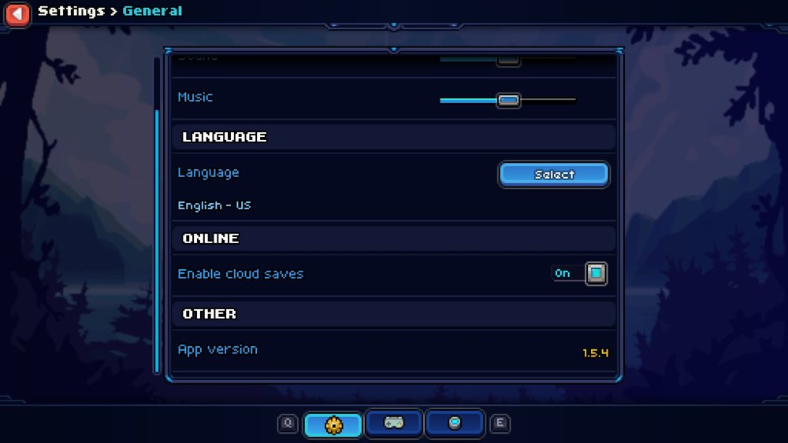

# Installation

## Install

1. **Check your game version.** In Coromon, open **Settings → General** and scroll to **App version** at the bottom.
   The latest release supports **v1.5.4**. On other versions some mods may not work.

   

2. **Find your game folder**, the one with `coromon.exe` in it.
   - Steam: right-click Coromon → **Manage** → **Browse local files**
     (usually `C:\Program Files (x86)\Steam\steamapps\common\Coromon`).
   - GOG: usually `C:\GOG Games\Coromon`.

3. **Download** the zip from the [latest release](https://github.com/zreezy/chalchiu-coromon/releases/latest) and unzip
   everything into the game folder. It should then look roughly like this (some files left out):

   ```
   📂 Coromon
   ├── coromon.exe
   ├── CoronaLabs.Corona.Native.dll
   ├── iphlpapi.dll      <- chalchiu
   ├── lua.dll
   ├── mods              <- the mods
   ├── optional          <- extra mods you can copy into mods (e.g. debug)
   ├── ...
   ```

4. **Start the game.** You should see:
   - a `chalchiu.log` file in the game folder,
   - the chalchiu version and the number of loaded mods in the window title,
   - the **Loaded Mods** list on startup (you can turn this off in Mod Info's settings).

Back up your saves before using mods, and see the warning in the [README](../README.md) about reporting issues.

## Update

Unzip the new release over the old files and replace them when asked. Your mod settings
(`mods/<mod>/settings.lua`) are not in the zip, so they are kept. If the [changelog](../CHANGELOG.md) says a mod was
removed, delete its folder from `mods`.

## Remove

- **One mod:** delete its folder from `mods`.
- **Everything:** delete `iphlpapi.dll`, `mods`, `optional` and `chalchiu.log` from the game folder. Without
  `iphlpapi.dll` the game runs unmodded.

## Troubleshooting

- **Nothing changes when the game starts** (no `chalchiu.log`, no version in the window title): `iphlpapi.dll` is
  not next to `coromon.exe`. Check that you unzipped into the right folder, not into a subfolder.
- **A mod doesn't show up or doesn't work:** open `chalchiu.log`. A mod that fails to load is skipped and the error
  is written there, the other mods still load.
- **Something behaves oddly:** `chalchiu.log` records what you do with the mods: which popups you open and close
  (and how), which buttons you press, setting changes and saves, hotkeys, and the messages mods show. Each game
  start begins with a `Loading Chalchiu` line and the game version, and the file keeps earlier sessions, so the
  most recent one is at the end. Attach it to bug reports.
- **The game crashes:** the log ends with the module and offset of the crash. Please
  [open an issue](https://github.com/zreezy/chalchiu-coromon/issues/new) with your game version and `chalchiu.log`.
