# Mods

The mods were originally written for Coromon v1.1.2 and have been updated for v1.5.4 (Solar2D 2026.3729).

| Mod | What it does | Default key |
|---|---|---|
| [Mod Info](#mod-info) | Lists the installed mods and lets you change their settings | Title screen **Mods** button |
| [Coromon Trainer](#coromon-trainer) | Game speed, noclip, catch all, skip battles, gold, items and more | `numPad` keys |
| [Potent Alert](#potent-alert) | Notification and sound when a potent or perfect Coromon appears | |
| [XP & Gold Boost](#xp--gold-boost) | Multiplies battle XP (2x) and trainer gold | |
| [Text Speed+](#text-speed) | Dialogue text faster than the game's 3x maximum (6x) | |
| [Area Encounter Info](#area-encounter-info) | Lists the Coromon in your current area, how common they are and which you've seen | `numPad0` |

## Changing settings

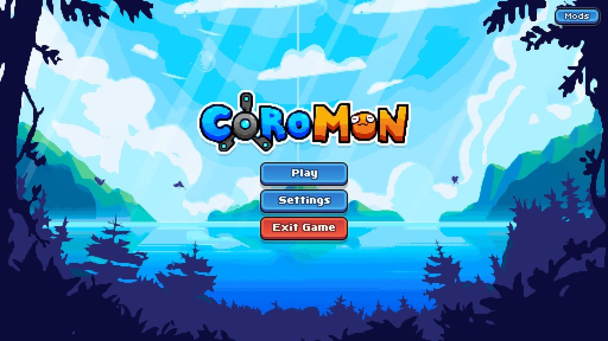

Every mod's settings, including all hotkeys, can be changed in-game:

1. Open the **Loaded Mods** list: it's shown on startup, with the **Mods** button on the title screen, or with the
   info button next to your gold in the pause menu.
2. Select a mod and press **Settings** (mods without settings say so in their description).
3. Select a setting and press the blue button. Its label says what it does:
   - **Turn on** / **Turn off** for on/off settings,
   - **Next** to step to the next value or option,
   - **Set key** for hotkeys: press the new key, `Esc` to cancel or `Backspace` to remove the key.
4. Press the red button (or `Esc` / `Backspace`) to go back to the list, and again to close it. Clicking outside
   the popup does nothing.

On a Steam Deck, tap the **Mods** button, then use **A** and **B** or tap. See [Steam Deck](steam-deck.md#controls).

Coromon's keys apply here too: `Space` or `Z` presses the blue button, and the game's Start keys (`Esc`, `Enter`,
`Right Shift`) and Back keys (`Backspace`, `X`, `Left Shift`) go back.

Changes are saved right away to `mods/<mod>/settings.lua`, there is no save button. You can also edit that file
directly while the game is closed. Delete it to go back to the defaults.

## Mod Info

Shows the installed mods, their versions and authors, and opens each mod's settings page.

It also tells you when a new chalchiu release is out: when the game starts it asks GitHub for the latest release,
and if it's newer than yours you get a message on the title screen and an **Update available!** row at the top of
the mod list. Its **Download** button opens the release page in your browser. Nothing else is sent, and you can turn
this off with **Check for updates**.

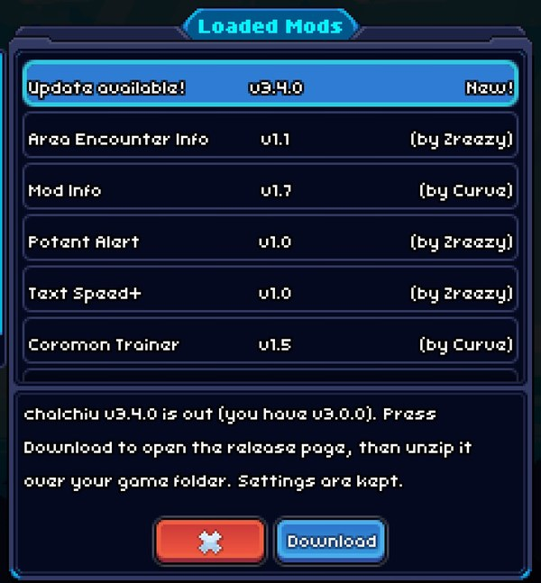

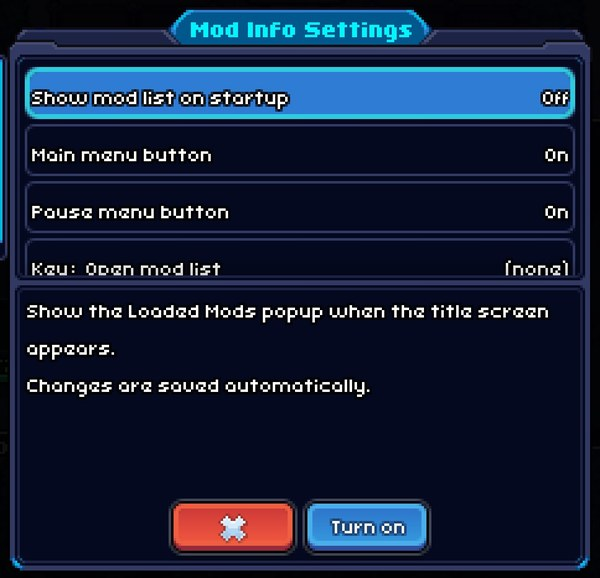

| Setting | Default |
|---|---|
| Show mod list on startup | On |
| Main menu button (the **Mods** button on the title screen) | On |
| Pause menu button (info button next to your gold) | On |
| Check for updates (asks GitHub once per game start) | On |
| Key: Open mod list | Not set |

## Coromon Trainer

Hotkeys for cheats and conveniences. Battle cheats are switched off automatically when an online battle starts and
can't be turned on during one.

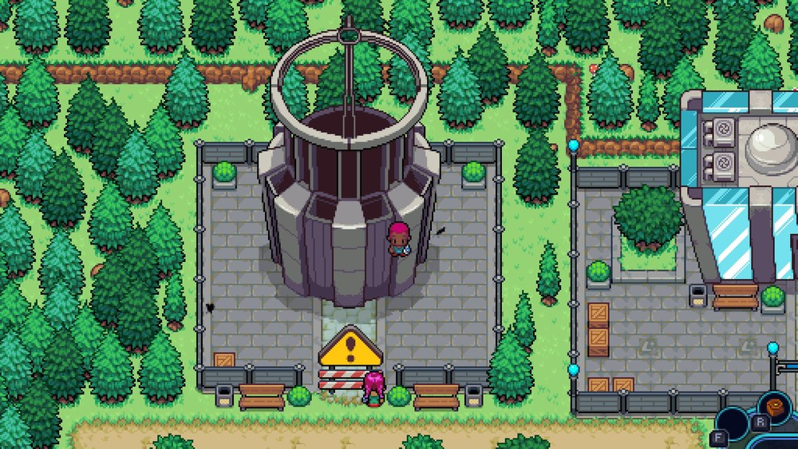

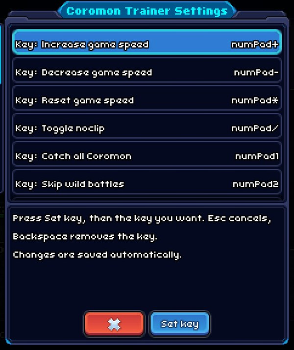

| Default key | Action |
|---|---|
| `numPad+` / `numPad-` / `numPad*` | Increase / decrease / reset game speed |
| `numPad/` | Toggle noclip |
| `numPad1` | Catch all Coromon |
| `numPad2` | Skip wild battles |
| `numPad3` | Max out squad (level, potential, health and energy) |
| `numPad.` | Max potential only: sets your squad to perfect potential (21), nothing else |
| `numPad4` | Add gold |
| `numPad5` | Skip trainer battles |
| `numPad6` | No energy cost |
| `numPad7` | Fast battle intros |
| `numPad8` | Hide world interface (for screenshots) |
| `numPad9` | Give item |
| Not set | No move damage (affects everyone in the battle) |

Settings: every key above. **Add gold: amount** (5000 by default) comes right after the Add gold key, and
**Give item: item** (Spinner by default) and **Give item: amount** (10 by default) right after the Give item key.

## Potent Alert

A notification and sound when a potent or perfect Coromon appears in a wild battle.

Settings: **Alert for potent Coromon**, **Alert for perfect Coromon** and **Play a sound** (all on by default).

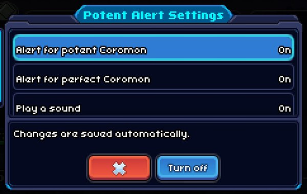

## XP & Gold Boost

Multiplies the XP earned in battles and the gold from trainer battles. No effect in online battles.

Settings: **XP multiplier** (2x by default) and **Trainer gold multiplier** (off by default), each from off up to 10x.

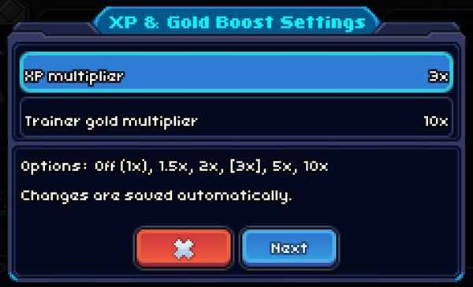

## Text Speed+

Makes dialogue text faster than the game's 3x maximum.

Settings: **Text speed**: use the game's setting, 4x, 6x (default), 10x or 25x.

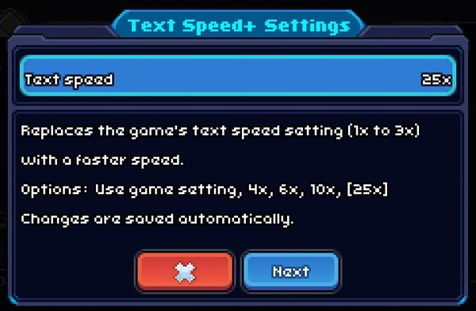

## Area Encounter Info

Press `numPad0` in the overworld to list the Coromon that live in your current area. Each row shows:

- the dex number and name (`???` for Coromon you haven't seen yet),
- **Caught**, **Seen** or **Not seen**,
- roughly how common it is, as a share of the area's encounters (e.g. `~12%`). The game adds up the encounter
  weights of every zone in the area (grass, water, ...), so this is approximate.

Select a row to read its dex description. The blue **Pictures** button opens the game's own world map popup for the
area. Doesn't work during battles, or when your save randomizes every encounter.

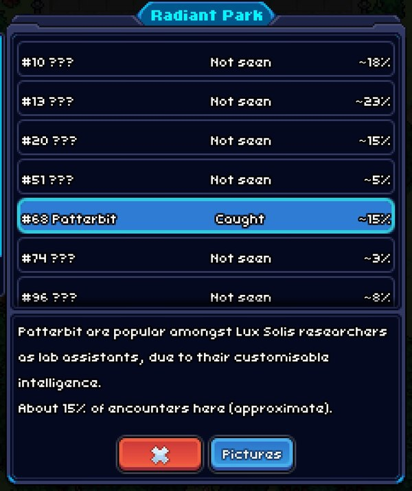

The **Pictures** view, here with **Show undiscovered Coromon** turned on (otherwise Coromon you haven't seen are
silhouettes):

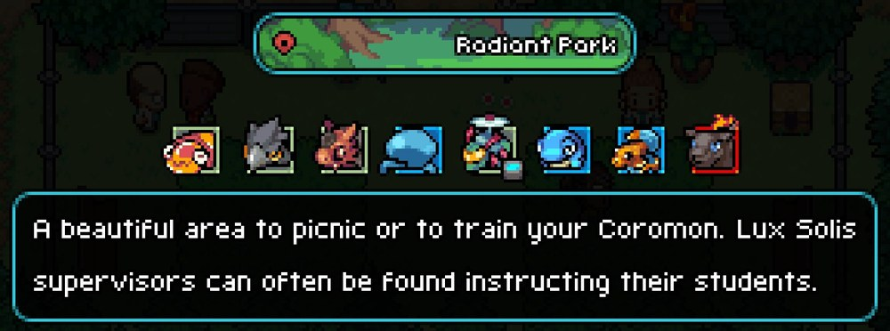

| Setting | Default |
|---|---|
| Key: Show area encounters | `numPad0` |
| View: **List with names** or **Game's map popup** (what the key opens) | List with names |
| Show undiscovered Coromon: reveal names in the list and pictures in the game's popup (spoilers) | Off |

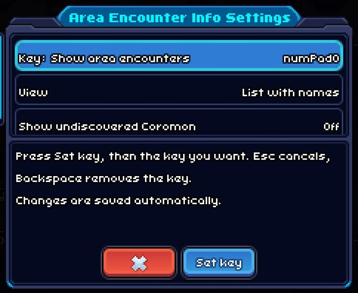

## Optional: debug

In the `optional` folder of the release. Copy it into `mods` to dump every module the game loads into
`chalchiu.log`. Only useful when [writing mods](writing-mods.md).

## Removed: Randomize Evolution

Randomized evolutions are now built into the game's Custom Difficulty screen, so this mod was removed. If you still
have `mods/random_evolution`, delete it.
